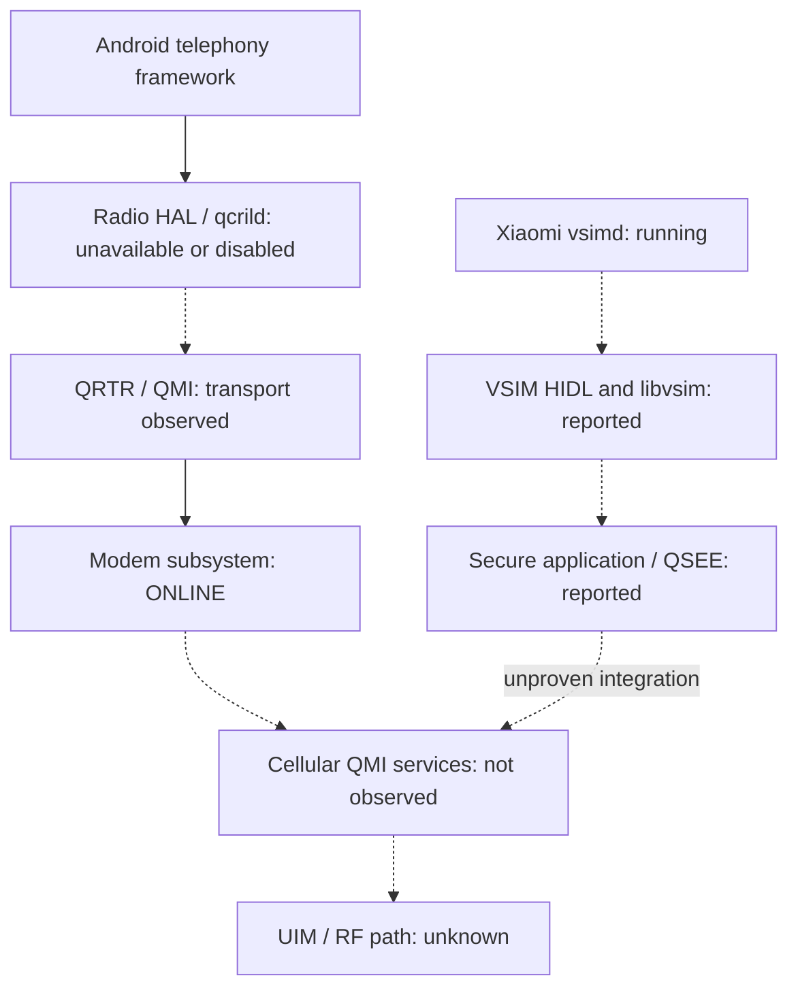

# Architecture and feasibility

Nabu: Xiaomi Pad 5 Wi-Fi, Snapdragon 860 / SM8150 platform. Android with Magisk root, Windows dual boot. SoC family LTE capability does not establish board-level RF capability or a cellular-enabled SKU.

## Candidate approaches

1. Native Xiaomi VSIM: investigate service presence and documented interface. It may be a proprietary roaming system, not a GSMA eSIM. Enrollment, entitlement and modem integration are unproven.
2. Standard eSIM: needs compatible eUICC (or supported integrated implementation), EID, LPA, authorized operator profile and radio support. A preinstalled LPA alone proves none of these.
3. Remote SIM: investigate supported client/server interface; APDU definitions alone do not establish a working transport. Use authorized test cards only; do not extract or duplicate subscriber secrets.
4. Physical SIM or MFF2 eUICC: determine whether UIM signals, supply, RF transceiver, PA/filter paths and antennas exist using board documentation and inspection. Do not use the conceptual diagram as a pinout.
5. External USB modem: fallback for connectivity, separate from native cellular objective.

Donor candidates for offline comparison: Poco X3 Pro (vayu, SD860), Mi 9 / Mi 9T Pro (SD855), Pad 5 Pro 5G (different modem platform), Mi 8 (SD845; mechanical SIM socket donor only). Similar SoC does not imply signed firmware, board, RF or calibration compatibility.

## Unresolved gates
- Cellular QMI service availability and reason for absence (firmware variant, policy, transport or board SKU).
- Actual VSIM HAL registration, interface version and method signatures.
- eUICC/EID and carrier compatibility.
- Physical RF and UIM routing, calibration and safe transmission.
